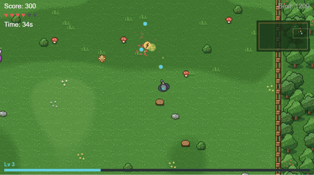

<div align="center">

# Incursio

[English](README.md) | **Türkçe**

*Latincede "istila" demek.* Doğrudan tarayıcıda çalışan, hızlı tempolu, yukarıdan bakışlı bir nişancı oyunu.<br>
Sıfırdan saf JavaScript ve HTML5 Canvas API ile yazıldı. Oyun motoru, kütüphane veya derleme adımı yok.

### [▶ Hemen Oyna](https://enes0102.github.io/incursio/)



</div>

## Hakkında

Zamanla daha hızlı, daha dayanıklı ve daha kalabalık hale gelen sonsuz düşman dalgalarına karşı olabildiğince uzun hayatta kal. XP toplayıp seviye atla, birikebilen yükseltmelerle kendi karakterini kur, her dakika gelen yeni bir boss'u alt et ve en yüksek skorun peşine düş.

> Oyun Türkçe ve İngilizce oynanabilir, ana menünün sağ üstündeki bayraklardan dili seçebilirsin.

## Kontroller

| Tuş | İşlev |
| --- | --- |
| `W` `A` `S` `D` | Hareket |
| Fare | Nişan alma |
| Sol tık (basılı tut) | Ateş etme |
| `F` | Otomatik ateşi açma / kapatma (varsayılan: açık) |
| `Space` | Atılma (Dash yükseltmesini alınca) |
| `1` `2` `3` / Tıklama | Seviye atlayınca yükseltme seçme |
| `Enter` / Tıklama | Oyunu başlatma |
| `R` | Oyun bitince tekrar oynama |
| `Esc` / `P` | Duraklatma / devam etme |
| `R` / `Q` (duraklatılmışken) | Yeniden başlatma / menüye çıkma |
| `Esc` (oyun bitince) | Menüye dönme |
| `M` | Sesi açma / kapatma |

## Özellikler

- **XP ve seviye sistemi**: yenilen düşmanlar parlayan XP kristalleri düşürür, her seviyede 17 yükseltmelik havuzdan çıkan üç karttan birini seçersin
- **Boss savaşları**: her 60 saniyede bir, her biri öncekinden güçlü
- **Ormanla çevrili, çitli büyük bir çayır** (yaklaşık 3×3 ekran), oyuncuyu takip eden kamera ve mini harita
- **Pixel art dünya**: doğal açık ve koyu bölgeleri olan çimen, ahşap çitler, ağaçlar, çiçekler, mantarlar, kütükler, çalılar ve taşlar
- **Akıcı hareket ve nişan alma**, kare hızından bağımsız fizik (delta time) ile
- **Otomatik ateş**, atış hızı sınırıyla: basılı tutmak da tıklamak kadar adil
- **Beş düşman tipi ve elite varyantları**, uzaktan saldıran ve hücum eden düşmanlar dahil
- **Dört güçlendirme**, yenilen düşmanlardan düşer
- **Dengeli zorluk eğrisi**: düşmanların sayısı, hızı ve canı zamanla artar, ilerleyen dakikalarda gruplar halinde gelirler; verdikleri XP de artar, böylece build'in zorluğa yetişebilir
- **Can barı**: 100 can, hasar sayıları ve az önce ne kadar can gittiğini gösteren, yavaşça eriyen "hayalet" bar; her düşman farklı miktarda hasar verir
- **Hasar sonrası dokunulmazlık**
- **Pixel art sprite'lar**, vurulunca beyaz yanıp sönme efektiyle
- **Oyun hissi efektleri**: parçacık patlamaları, ekran sarsıntısı, hasar flaşı ve yükselen yazılar
- **Prosedürel ses efektleri**, Web Audio API ile gerçek zamanlı üretilir, ses dosyası kullanılmaz
- **Kalıcı en yüksek skor**, tarayıcıda `localStorage` ile saklanır
- **Oyun ekranları**: başlangıç menüsü, duraklatma menüsü, seviye atlama ve oyun bitti ekranları
- **Türkçe ve İngilizce**: ana menüdeki bayraklara tıklayarak dil değiştirme
- **Otomatik ateş**: fareye basılı tutmadan imlecin yönüne ateş eder (`F` ile aç/kapat)

### Düşmanlar

| Düşman | Açıklama |
| --- | --- |
| 🔴 Normal | Standart düşman. Baştan itibaren gelir. |
| 🟠 Hızlı | Küçük ve çevik. 15. saniyeden sonra gelir. |
| 🟣 Tank | Büyük, yavaş ve 4 vuruşta ölür. 30. saniyeden sonra gelir ve daha sık güçlendirme düşürür. |
| 🟡 Spitter | Mesafesini korur ve uzaktan zehir tükürür. 5:00'ten sonra gelir. |
| 🔴 Charger | Durur, gideceği yolu kırmızı çizgiyle gösterir, sonra çok hızlı hücum eder. 7:00'den sonra gelir. |
| ✨ Elite | 8:00'den sonra her düşman altın parlayan bir elite olarak gelebilir: daha büyük, 3 kat can, 1.5 kat hasar, 3 kat ödül. %5 ile başlar ve her dakika artar. |

Bütün düşman hasarları her dakika %5 artar; yani her şeyi sonuna kadar almış bir build bile hareket etmek zorunda.

### Boss

Her 60 saniyede bir, önce bir uyarıyla taçlı dev bir canavar gelir. Yavaşça seni kovalar ve iki saldırı arasında geçiş yapar: her yöne mermi halkası ve sana nişanlı yelpaze atış. Her yeni boss'un canı daha fazladır (zamanla da artar), daha çok mermi atar ve daha sık saldırır. 3. boss'tan itibaren dönen bir sarmal mermi yağmuru, 5. boss'tan itibaren de minyon çağırma saldırısı eklenir. Onu yenmek büyük skor bonusu, bol XP ve garanti güçlendirme kazandırır.

### Yükseltmeler

| Yükseltme | Etkisi | Maks. |
| --- | --- | --- |
| Güçlü Atış (Power Shot) | Mermi hasarı +1 | 5 |
| Hızlı Tetik (Quick Trigger) | %15 daha hızlı ateş | 5 |
| Çoklu Atış (Multishot) | Her atışta +1 mermi | 3 |
| Delici Mermi (Piercing Rounds) | Mermiler +1 düşmanın içinden geçer | 3 |
| Çevik Botlar (Swift Boots) | %10 daha hızlı hareket | 5 |
| Mermi Hızı (Velocity) | Mermiler %20 daha hızlı uçar | 3 |
| Dayanıklılık (Vitality) | +20 maksimum can ve 20 can yenileme | 5 |
| Mıknatıs (Magnet) | XP'yi daha uzaktan toplama | 3 |
| Yenilenme (Regeneration) | Saniyede 0.8 / 1.4 / 2 can yenileme | 3 |
| Dönen Bıçaklar (Orbiting Blades) | Etrafında dönen 1 / 2 / 3 shuriken düşmanları keser | 3 |
| Kritik Vuruş (Critical Hit) | %10 / %20 / %30 ihtimalle 2 kat hasar | 3 |
| Patlayıcı Mermi (Explosive Rounds) | Ölen düşmanlar patlayıp yakındakilere hasar verir (zincirleme olabilir) | 3 |
| Zırh (Armor) | %10 / %20 / %30 daha az hasar | 3 |
| Atılma (Dash) | `Space` ile atılma, atılırken dokunulmazlık; bekleme süresi 3 / 2.2 / 1.5 sn | 3 |
| Can Çalma (Lifesteal) | Her öldürmede 0.5 / 1 / 1.5 can | 3 |
| Buz Aurası (Frost Aura) | Yakınındaki düşmanlar %25 / %35 / %45 yavaşlar (boss'a yarı etki) | 3 |
| Şans (Lucky) | Güçlendirmeler ×1.4 / ×1.8 / ×2.2 daha sık düşer | 3 |

Her seviye atlamada en az bir saldırı yükseltmesi teklif edilir, böylece hasarın her zaman zorluğa yetişebilir.

### Güçlendirmeler

| Güçlendirme | Etkisi |
| --- | --- |
| 🟢 `+` Health | 25 can yeniler |
| 🟡 `R` Rapid Fire | 6 saniye boyunca 2.5 kat hızlı ateş |
| 🔵 `3` Triple Shot | 8 saniye boyunca aynı anda üç mermi |
| 🟣 `S` Shield | Alacağın bir sonraki hasarı engeller |

## Yerelde Çalıştırma

Kurulum gerekmez. Repoyu klonla ve `index.html` dosyasını herhangi bir modern tarayıcıda aç:

```bash
git clone https://github.com/Enes0102/incursio.git
cd incursio
```

Düzenleme yaparken otomatik yenileme için VS Code'daki **Live Server** eklentisini kullanabilirsin.

## Proje Yapısı

```
incursio/
├── assets/
│   ├── gameplay.gif   # Oynanış önizlemesi
│   └── sprites/       # Pixel art sprite'lar (PNG)
│       └── tiles/     # Çimen, çit, ağaç ve süs karoları
├── index.html         # Sayfa ve canvas elementi
├── style.css          # Sayfa düzeni ve stil
├── game.js            # Tüm oyun mantığı: girdi, nesneler, efektler, ses ve çizim
├── README.md          # İngilizce dokümantasyon
└── README.tr.md       # Türkçe dokümantasyon
```

## Kullanılan Teknolojiler

- JavaScript (ES6+)
- HTML5 Canvas API
- Web Audio API
- CSS

## Geliştirici

**Enescan Güleryüz** — [@Enes0102](https://github.com/Enes0102)
